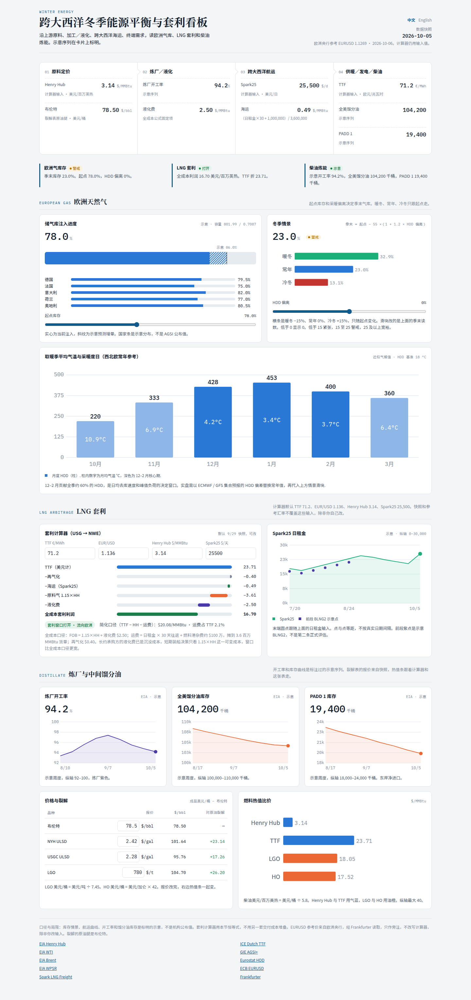
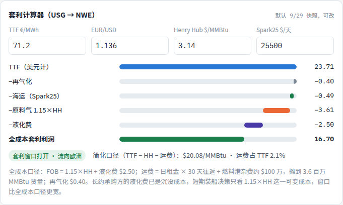
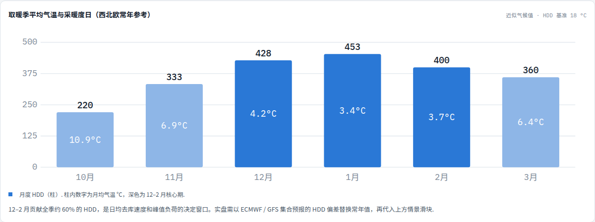

[https://iris0614.github.io/energy-dashboard/](https://iris0614.github.io/energy-dashboard/)

跨大西洋冬季能源平衡与套利看板 reads European gas storage, LNG arbitrage, and distillate from feedstock through Atlantic freight. The header switches between 中文 and English. Each card shows its observation date. Public series live in [`data.json`](data.json). TTF, Spark25, BLNG2, and European gasoil stay on the 2026-09-29 manual snapshot because ICE, Spark, and Baltic need a paid key.

Refresh the public fields (EIA HTML tables, Open-Meteo, Frankfurter, and the AGSI cross-section republished by Voltstack) with:

```bash
node scripts/refresh-data.mjs
```

The script does not call `agsi.gie.eu` directly. That API needs an `x-key`, so the weekday GitHub Action skips it too.

## Demo

Chinese desktop, full page.



Arbitrage waterfall. Each cost is subtracted from the right.



Heating-degree chart. The monthly mean temperature sits inside each bar.



## Local

```bash
python -m http.server
```

Then open [`index.html`](index.html). [`index.html`](index.html) and [`transatlantic-energy-dashboard.html`](transatlantic-energy-dashboard.html) are the same file.

[https://github.com/iris0614/energy-dashboard](https://github.com/iris0614/energy-dashboard)
